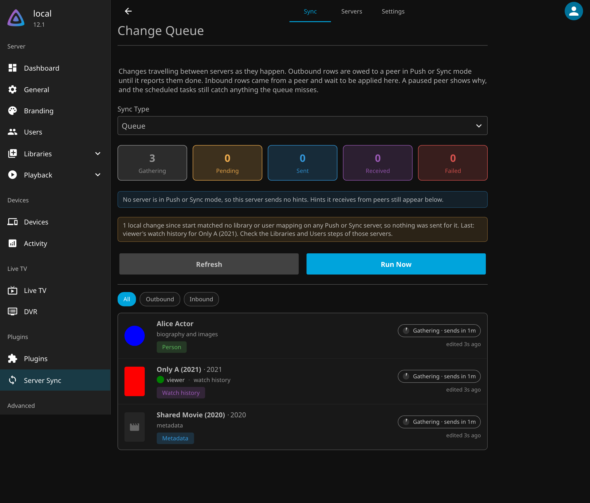

A Jellyfin plugin that keeps several Jellyfin servers in step. Keep your **Content**, **Watch History**, **Metadata**, **People**, and **User Settings** in sync across multiple Jellyfin installations, on a schedule and, between servers that both run the plugin, as changes happen.

## How It Works

Server Sync runs on your Local (destination) server and pulls data from one or more Source servers using standard Jellyfin APIs. You configure each server with its own library and user mappings, then two scheduled tasks, **Sync Content** and **Sync Information**, handle the synchronization. Content is matched by file path, allowing the plugin to track what needs to be downloaded, updated, or removed. No modifications are required on a Source server that is only scanned.

When a Source server also runs Server Sync, the two can keep each other current between scheduled runs. A server entry in **Push** or **Sync** mode is told about changes as they happen, from a play or a favorite to a metadata edit, a person edit, or a new file, and pulls each change within seconds. User settings travel on the scheduled task only, since Jellyfin raises no event for them. The scheduled tasks remain the safety net. See **[Live Changes](#live-changes-between-servers)**.

When several servers are configured, their order is their priority. If two servers offer the same item, the server higher in the list supplies it and the lower one only contributes what the higher one lacks. Reordering the list moves an item to the new winner on the next refresh without deleting anything already downloaded.

## Use At Your Own Risk

This plugin modifies live data on your Jellyfin server. While extensively tested, I maintain this plugin for my person use case and I do not account for every server configuration. **Always maintain backups of your Jellyfin data and configuration.** By using this plugin, you accept full responsibility for any data loss or issues that may occur.

# Before You Start

**Matching libraries is the core rule.** Server Sync matches files by their path relative to each mapped library's root folder. Both servers must keep the same folder and file structure under that root.

| Source | Local | Matches |
| :--- | :--- | :--- |
| `/media/Movies/Film (2020)/Film (2020).mkv` | `/data/Movies/Film (2020)/Film (2020).mkv` | Yes, with roots `/media/Movies` and `/data/Movies` |
| `/media/Movies/Film (2020)/Film (2020).mkv` | `/data/Movies/Film/Film.mkv` | No, the names differ |

* A library must be a single folder.
* A renamed file on the source is usually downloaded again under its new name, and the old one is handled by **Removed files**.
* Interrupted downloads start over, and a changed file is found by its size.
* Every server in a pool runs the same Server Sync version. A server on another version is left alone until both match.

# Setup

The plugin has three tabs. **Sync** shows each module's table and the change queue. **Servers** holds the servers this one syncs with. **Settings** holds the options.

## Servers

| Servers Tab |
| :--- |
|  |

Servers higher in the list win when two offer the same item. Drag a server to change the order. Each server has four steps.

| Step | What it holds |
| :--- | :--- |
| 1. Connection | Name, Server URL, an optional External URL for thumbnails, and whether a LAN address is allowed |
| 2. Authentication | An API key or a sign in, Test Connection, what the key can do there, and the Direction |
| 3. Libraries | Which library there maps to which library here, their root folders, and a filter |
| 4. Users | Which user there maps to which user here, for history, user settings, and playlists |

| Connection | Authentication |
| :--- | :--- |
|  |  |

| Library Mapping | User Mapping |
| :--- | :--- |
|  |  |

**Test Connection** shows who the key belongs to, whether it may download, whether Server Sync there lets it in, and what each module can do with it.

### Direction

| Direction | Needs Server Sync there | What happens |
| :--- | :--- | :--- |
| Pull | No | This server reads from that one on a schedule. Changes also arrive as they happen when that server pushes to this one |
| Push | Yes, listing this server as Pull or Sync | Changes made here are sent to that server as they happen |
| Sync | Yes, listing this server as Sync | Both, for a pool of equals |

**Check Link** confirms the other server is set up for the chosen direction and reports the access it holds for this one.

### Keys and Permissions

A standard user's key works in every direction, limited to what that user can see and that user's own history, settings, and playlists. An administrator's key or an API key reaches everything. See **[Permissions](docs/Permissions.md)** for each function.

## Settings

| Settings Tab |
| :--- |
|  |

| Section | What it holds |
| :--- | :--- |
| Processing | How long changes wait before they are sent, retries, parallelism, and how often a full scan runs |
| Whitelist | Who may call this server's sync endpoints. Administrators and API keys from servers on the Servers tab always may. Add users with the locations they may call from |
| Synchronization | One section per sync type, each with a table of what a standard user and an administrator can do |
| Troubleshooting | Table resets, which forget tracking but never touch media |

**Updating from before 12.2.7:** servers that pull from this one without being on its Servers tab need a Whitelist row here. The update adds API keys and every administrator with all locations so nothing breaks. Narrow those rows to lock it down.

# Sync Types

Two scheduled tasks do the work. **Sync Content** refreshes and downloads files, handles removed files, and mirrors collections. **Sync Information** compares and applies metadata, people, user settings, and history, then copies playlists.

| Type | Matched by | Live with Push or Sync | Details |
| :--- | :--- | :--- | :--- |
| Content | File path under the library root | New files | [Content](docs/Content.md) |
| History | File path and user mapping | Yes, merged three way | [History](docs/History.md) |
| Metadata | File path | Yes, newest edit wins | [Metadata](docs/Metadata.md) |
| People | Name | Yes, newest edit wins | [People](docs/People.md) |
| Users | User mapping | No, scheduled only | [Users](docs/Users.md) |
| Playlists | Owner mapping, items by file path | Yes, including deletions | [Playlists](docs/Playlists.md) |

| Sync Table | Item Detail |
| :--- | :--- |
|  |  |

## Content

Files missing here are downloaded, changed files are replaced, and **Approvals** decides which of these wait for you. **Removed files** decides what happens to a file that is gone from the source.

| Removed files | What happens |
| :--- | :--- |
| Keep | The file stays |
| Delete | The file is deleted. Uncertain cases wait for approval |
| Delete After Approval | Every deletion waits for approval |
| Ignore | Once everything in a movie or show folder is gone from the source, a `.ignore` file hides that folder from Jellyfin and the files stay. A season is never hidden on its own |

Deleting a file from the Sync tab keeps its row as **Ignored**, so it is not downloaded again. Queue the row to bring it back.

## Live Changes

Servers that both run Server Sync tell each other about changes as they happen. A change is sent as a hint that says what changed, never the value, and the other server pulls the value itself. Hints wait until an item has gone untouched for **Send Changes After**, are retried until delivered, and show on the **Queue** view.

| Change Queue | On a phone |
| :--- | :--- |
|  |  |

* **No echoes.** A write made because of a hint is never announced back, a value that already matches is never written, and an object announced more than ten times in ten minutes is held back for the scheduled task.
* **Conflicts.** History merges three way against what the two servers last agreed on. Everything else goes to the newest edit.
* **Pairing.** Servers that list each other share a secret, so one server cannot pretend to be another.
* **Only what is wanted.** A server only announces what the other side maps and has turned on.

## Metadata Provider

Server Sync is also a metadata and image provider for every media type. Turn on **Server Sync** in a library's metadata and image fetchers, above the others.

* **Refresh** reads from the highest server that has the item, found by path, then provider ids, then show ids with season and episode numbers, and by name for people, artists, and collections.
* **Identify** lists every server that has the item, named after its server, in the Servers tab order. Picking one pins the item to that server, shown as **Server Sync Item** among its external ids.
* **Images** lists the images of every server that has the item, the pinned one first, each named after its server.

## API

Server Sync adds routes under `/Sync`. See the **[API reference](docs/API.md)**.

---

# Versioning

Releases use a four part version, `JJ.JJ.F.B`, that matches the supported Jellyfin version with the plugin's own feature and bug count:

```
12.0.1.2
└──┘ └┬┘
 │    └── 1 = Plugin feature release
 │        2 = Plugin bug/patch release within that feature
 │
 └─── 12.0 = Jellyfin version this build was tested/released for
```

# Installation

## Step 1: Add Plugin Repository

* Open Jellyfin and navigate to Dashboard → Plugins → Repositories
* Click Add Repository
* Enter the following repository URL: `https://raw.githubusercontent.com/JPKribs/jellyfin-plugin-serversync/master/manifest.json`
* Click Save

## Step 2: Install Plugin

* Go to the Catalog tab in the Plugins section
* Find Server Sync in the catalog
* Click Install
* Wait for installation to complete

## Step 3: Restart Jellyfin

* Restart your Jellyfin server completely
* Wait for Jellyfin to fully start up

## Verification Check

* After restart, navigate to Dashboard → Plugins → Server Sync to confirm the plugin configuration page loads properly.

---

## AI Disclaimer

Anthropic's Claude Code is utilized in the development and maintenance of this project.
