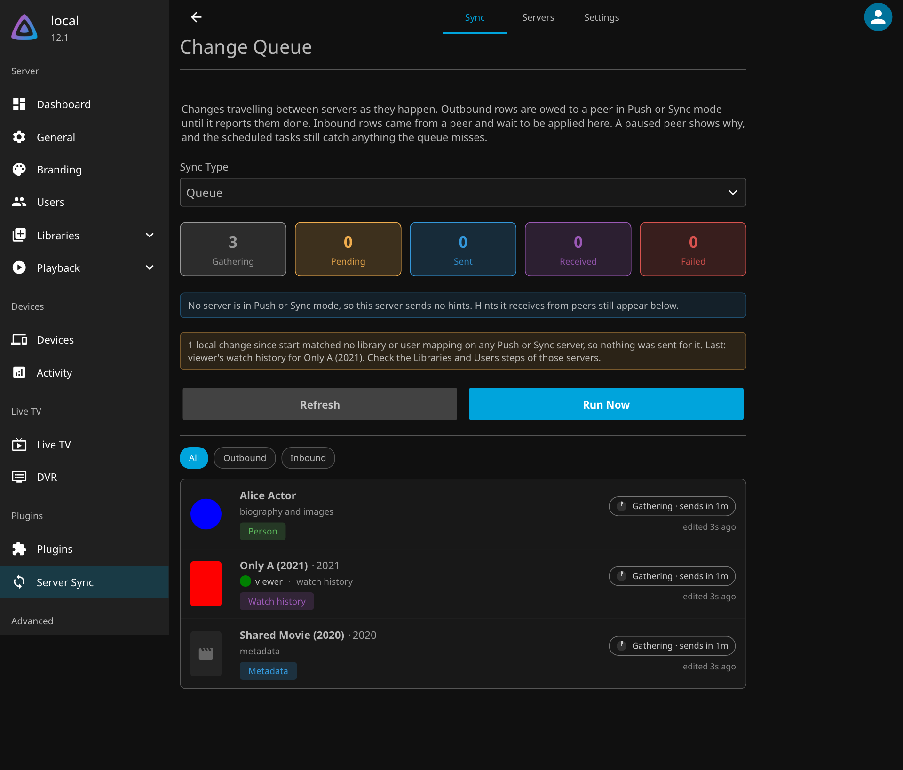

# Live Changes

Servers that both run Server Sync tell each other about changes as they happen. A change is sent as a hint that says what changed, never the value, and the other server pulls the value itself. Hints wait until an item has gone untouched for **Send Changes After**, are retried until delivered, and show on the **Queue** view.

| Change Queue | On a phone |
| :--- | :--- |
|  |  |

* **No echoes.** A write made because of a hint is never announced back, and a value that already matches is never written. An item a peer changed that is announced more than ten times in ten minutes is held back for the scheduled task. Deletions always go out.
* **Conflicts.** History merges three way against what the two servers last agreed on. Everything else goes to the newest edit.
* **Pairing.** Servers that list each other share a secret, so one server cannot pretend to be another.
* **Only what is wanted.** A server only announces what the other side maps and has turned on.
* **Compatible versions only.** Servers on different Server Sync versions exchange changes while their protocols overlap. Changes for a server whose protocol does not overlap wait in the queue until it does. See [Versioning](Versioning.md).

## Activity Log

Changes from other servers are summed on the dashboard's Activity page rather than listed one by one. Once no change has arrived for 30 seconds, or every 5 minutes during a long sync, one entry is written per outcome:

| Name | Overview |
| :--- | :--- |
| 12 Items Synced | 12 items were synced from source-a (9), source-b (3) |
| 3 Items Not Synced | 3 items from source-a (2), source-b (1) were not synced: filtered out (2), ignored here (1) |
| 4 Items Retrying | 4 items from source-a (4) could not be applied yet and will be retried |

A server's own events are written as they happen: **Changes Paused for** a server that cannot take them, **Changes Rejected by** one that refused a request as malformed, and **Changes Resent to** one that lost changes it had accepted. Each change is still in the server log, and in the Change Queue on the Sync tab.

A paused server is left alone until the pause runs out. Changing its address, key, or direction on the Servers tab ends the pause, so the waiting changes go out on the next pass.
