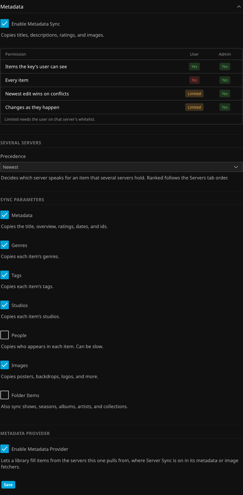

# Metadata Syncing

Metadata syncing copies item details from a source Jellyfin server onto matching local items.

## Settings

* **Enable Metadata Sync** turns metadata syncing on.
* **Metadata** syncs core fields such as titles, overviews, and dates.
* **Genres** syncs item genres.
* **Tags** syncs item tags.
* **Studios** syncs item studios.
* **People** syncs who appears in each item. A full scan reads an item's cast only when the item is new, the source saved it since the last scan, or its other details changed, since building a cast is most of the source's work. An edit announced as a live change always reads it.
* **Images** syncs item images such as posters and backdrops.
* **Folder Items** also syncs metadata for container items such as series and seasons.
* **Enable Metadata Provider** lets a library fill items from the servers this one pulls from, where Server Sync is on in its metadata or image fetchers. It is on by default and works only while **Enable Metadata Sync** is on. See [Metadata Provider](MetadataProvider.md).
* **Precedence** chooses which server is heard for an item that several servers hold, either the one whose edit is newest or always the highest ranked. See [Several Servers](SyncTypes.md#several-servers).

The library filter on the **Storage** tab applies to metadata as it does to content.

## Images

When an item's images differ from the source, this server downloads the full source set for that image type, then replaces its own set for that type with it. If a download fails, the existing images are kept and the row is marked Errored. The whole set is replaced because an item can hold several of them. A source with two backdrops over a local five has to remove the extra three files. Otherwise the next library scan picks them up again and the difference comes straight back.

A scan tells whether an image changed from the tag the source gives it, which changes whenever the source writes the image again. Once an image here has been matched to the source's, an unchanged tag means no change, and a new tag means the image is fetched. An image that has never been matched is compared by file size, so images already on both servers are matched without being downloaded.

**Refresh Parallelism** and **Deep Image Verification** apply to Metadata and People and live under **Settings > Processing**. Refresh Parallelism also sets how many requests a Metadata scan sends to a server at once, so lower it for a slow server. Deep Image Verification measures every source image on every scan and compares by size, which also catches an image file swapped on the source's disk before the source has noticed.

## Live Changes Between Servers

When a server entry is set to **Push** or **Sync**, a metadata edit made here is announced to that server as it happens, and that server pulls the item through the same code the scan uses, images included. Only an edit raises a hint. Metadata a provider downloads and images a provider refreshes are left to the scheduled scan, so a server that fetches its own metadata after receiving a file does not push it over the other server's curated values the moment it arrives.

When the two servers disagree, the newest edit wins, unless **Precedence** is set to **Ranked**. Each server remembers where and when every tracked value was last edited, and a copy carries the stamp of the edit it came from rather than the time it landed. This applies to hints and to the full scan alike. Against a server that runs Server Sync, a scan keeps a local value that was edited more recently than the other server's, marks the row with that reason, and tells the other server to pull it. Against a server without the plugin the source wins.
