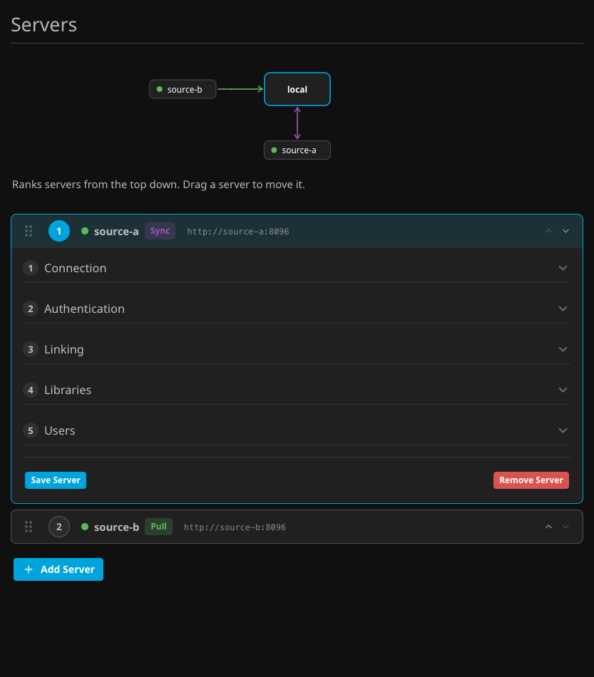
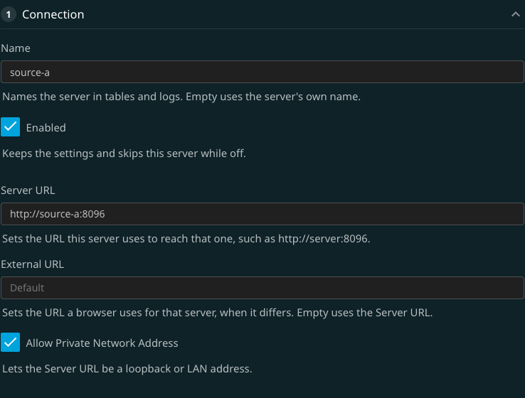
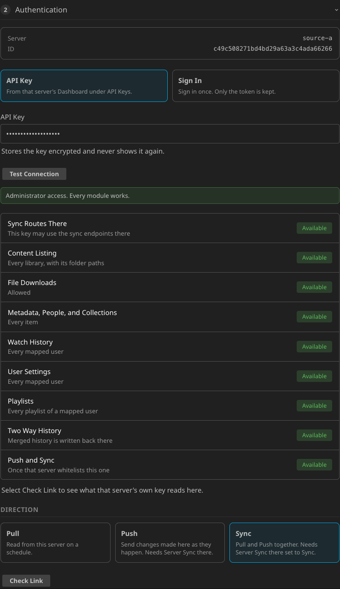
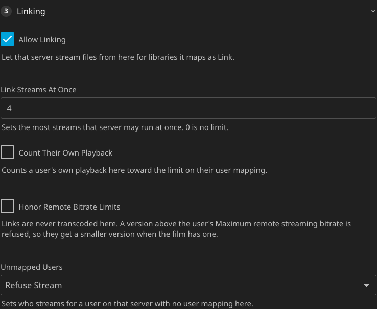
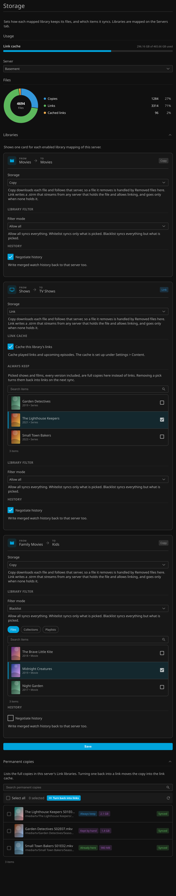
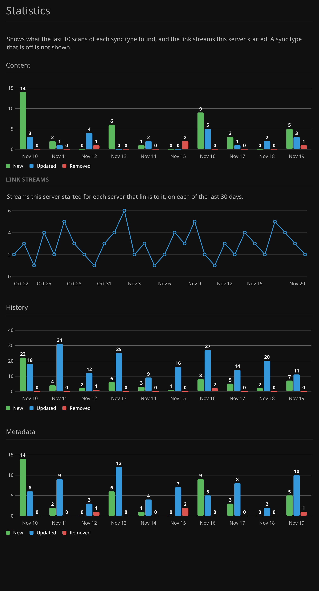
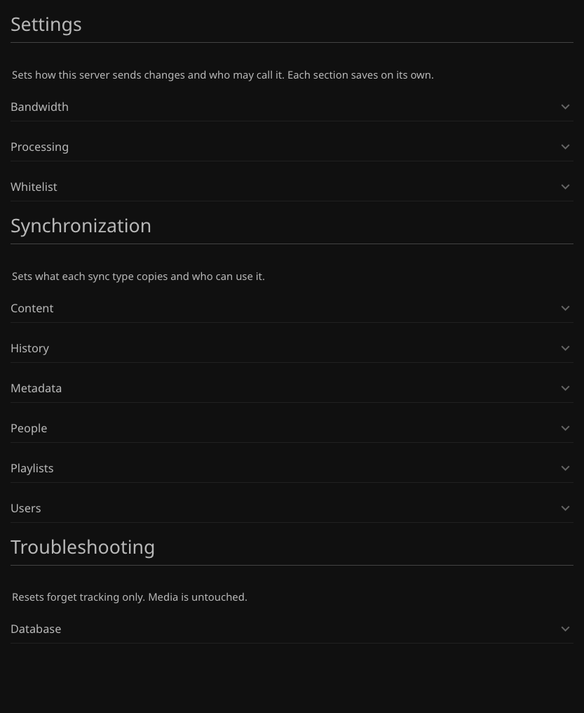

# Setup

The plugin has five tabs. **Sync** shows each sync type's table and the change queue. **Servers** holds the one time setup of the servers this one syncs with. **Storage**, shown while content, history, or metadata sync is on, holds how each mapped library keeps its files and which items it syncs. **Statistics** charts what the last scans found. **Settings** holds the options.

## Servers

The map at the top shows this server by its own name, and every server it is set up with, grouped by direction. Every arrow points the way things travel. Pull points here, Push points out, and Sync points both ways. The servers this one pulls from are on the left, the servers it pushes to are on the right, and the servers it syncs with are below. Each lane's line is the color of that direction's badge on the server cards. Each server's dot is green when it runs Server Sync, orange when it answers without it, red when it cannot be reached, and gray when it is disabled.

A server's place in the list is its rank, and servers higher in the list rank first. Drag a server to change the order. Each server has these steps.

| Step | What it holds |
| :--- | :--- |
| 1. Connection | **Name**, **Server URL**, an optional **External URL**, and **Allow private network address** |
| 2. Authentication | An **API Key** or a **Sign in**, **Test connection**, what the key can do there, and the Direction |
| 3. Linking | For Push and Sync servers, **Allow linking**, the stream limit, and who unmapped users stream as. A warning shows when that server does not run Server Sync |
| 4. Libraries | Which library there fills which library here, and their root folders. How each one keeps its files is set on the [Storage](#storage) tab |
| 5. Users | Which user there maps to which user here, for history, user settings, and playlists, and, with Allow linking on, that user's own link stream limit and speed |

**The other server needs Server Sync for everything but a plain pull.** A server that runs plain Jellyfin can be a **Pull** server whose libraries are kept as copies, and nothing else. Saving an entry as Push or Sync, or with a library kept as links, is refused when that server answers and does not run Server Sync, or runs one too far from this version for the two to talk. A server that cannot be reached is saved, since it cannot be asked, and nothing is sent to it until it answers.

Steps are numbered in the order they show, so a Pull server's Libraries is step 3.

**Allow private network address** lets a server entry use a loopback, LAN, or carrier NAT address. Carrier NAT is 100.64.0.0/10, the range Tailscale uses. With it off, only public addresses are reached, and a plain `http://` URL is refused, since it would send the API Key unencrypted.

| Connection | Authentication |
| :--- | :--- |
|  |  |

| Library Mapping | User Mapping |
| :--- | :--- |
|  |  |

**Test connection** shows who the key belongs to, whether it may download, whether Server Sync there lets it in, and what each sync type can do with it.

### Direction

| Direction | Needs Server Sync there | What happens |
| :--- | :--- | :--- |
| Pull | No | This server reads from that one on a schedule. Changes also arrive as they happen when that server pushes to this one |
| Push | Yes, listing this server as Pull or Sync | Changes made here are sent to that server as they happen, and it may download this server's files. This server reads nothing from it |
| Sync | Yes, listing this server as Sync | Both, for a pool of equals |

**Check link** confirms the other server is set up for the chosen direction. It answers with a verdict and a line for each thing it learned. These are how that server lists this one, which way changes travel, what it applies from this server, what it reads here, whether the two are paired, and the two clocks when they differ.

### Links

**Allow linking** in the Linking step, and **Storage** set to **Link** on the **Storage** tab, hold a library as `.strm` links that stream from the source instead of full copies. The source allows linking on its entry for this server, and this server sets Storage on its entry for the source. Links that are played can also be kept in a link cache, set under Content in Settings. A Pull server can never link here. See [Links](Links.md).

### Keys and Permissions

A standard user's key works in every direction. It is limited to what that user can see and to that user's own history, settings, and playlists. An administrator's key or an API key reaches everything. See [Permissions](Permissions.md) for each function.

## Storage

The **Storage** tab shows while content, history, or metadata sync is on. Pick a server, and each of its enabled library mappings has a card. With content sync off, only the filter and history settings show:

| Setting | What it holds |
| :--- | :--- |
| Storage | Full **Copy** files, the default, which follow that server: a file it removes is handled by **Removed files** here. Or **Link** files, which stream from any server that holds the file and go only when none holds it. See [Links](Links.md) |
| Link cache | For a Link library, whether its played links are kept in the link cache |
| Always keep | For a Link library, the shows and films that are full copies instead of links |
| Library filter | **Allow all**, or a **Whitelist** or **Blacklist** of files, collections, and playlists. It applies to content, history, and metadata. See [Content](Content.md#collection-syncing) |
| Negotiate history | For a Sync server, while history sync is on, whether merged watch history is written back to that server. See [History](History.md) |

Below the cards, **Permanent copies** lists the full copies held in that server's Link libraries and why each is a copy. **Turn back into links** makes the selected copies links again. The link is written, then the copy moves into the link cache, or is removed when the cache is off or full. The source must still have the file. A copy covered by an Always keep pick stays a copy until the pick is removed.

## Statistics

The **Statistics** tab has one section for each sync type that is on. Each charts what the last 10 scans of that sync type found:

| Bar | Counts |
| :--- | :--- |
| New | Items the scan tracked for the first time |
| Updated | Items that were in step and that the scan found changed on a source |
| Removed | Items the scan stopped tracking, since no source holds them any more |

A scan of a sync type runs from its scheduled task or from **Refresh** on the **Sync** tab. An item that is already waiting to sync is not counted again by a later scan.

While a server may link to this one, the tab also charts **Link streams**, under **Content** when content sync is on and in a section of its own when it is off: how many streams this server started for each such server on each of the last 30 days, one line for each server. A film counts once however often its player seeks. See [Links](Links.md).

## Settings

| Section | What it holds |
| :--- | :--- |
| Bandwidth | Every speed limit, in Mbps, where 0 is no limit. **Downloads** is shared by every download to this server, and a **Streams to** row covers each server allowed to link. Each has a **Normal** and a **Scheduled** speed, and **Scheduled speed** uses the second one during the set hours |
| Processing | How long changes wait before they are sent, retries, parallelism, and how often a full scan runs |
| Whitelist | Who may call this server's sync routes, and from where. Administrators and API keys calling from an enabled server on the **Servers** tab always may |
| Content, History, Metadata, People, Playlists, Users | One section per sync type, each with a table of what a standard user and an administrator can do. Options that do not apply are hidden |
| Troubleshooting | Resets for each sync table, which forget tracking and never touch media |
