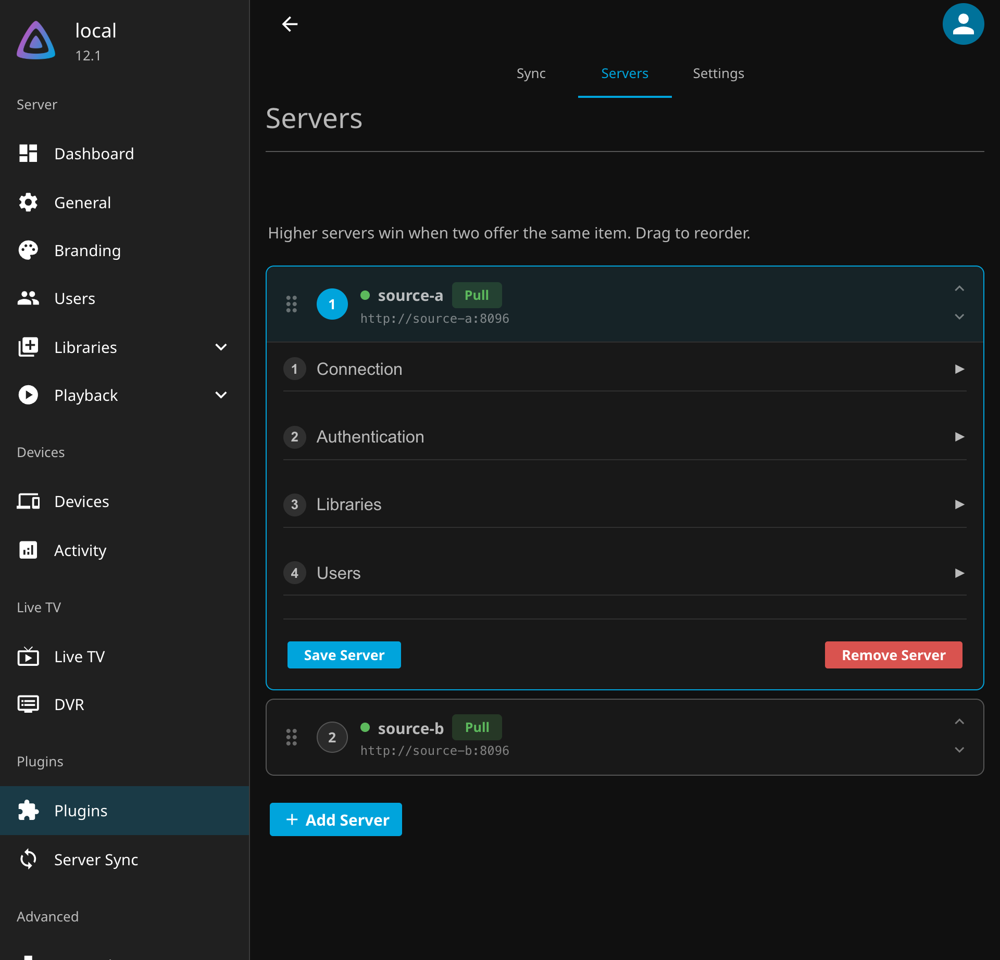
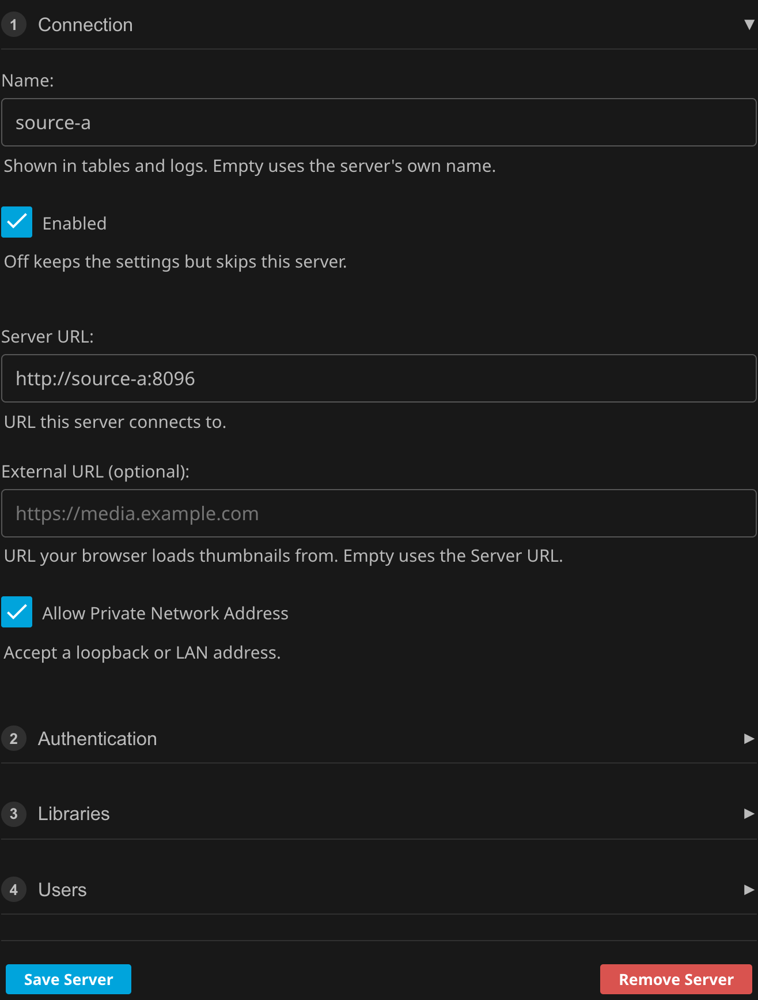
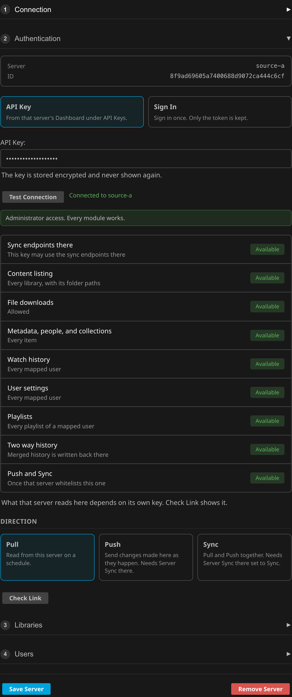
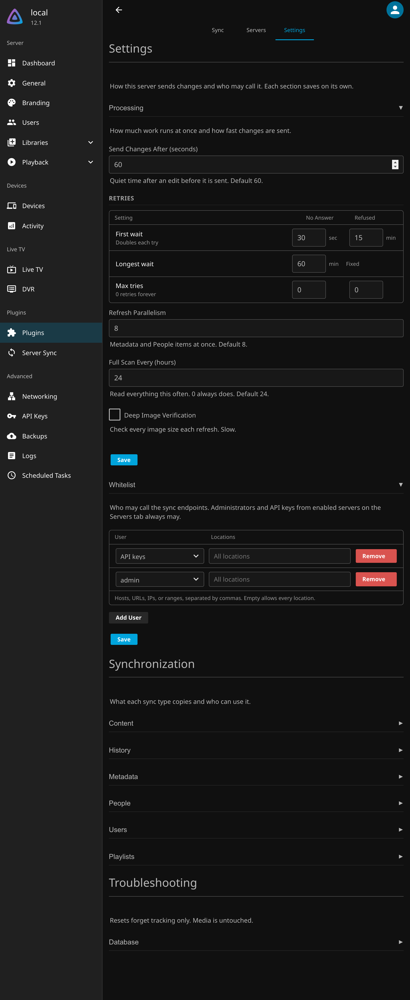

# Setup

The plugin has three tabs. **Sync** shows each module's table and the change queue. **Servers** holds the servers this one syncs with. **Settings** holds the options.

## Servers

Servers higher in the list win when two offer the same item. Drag a server to change the order. Each server has four steps.

| Step | What it holds |
| :--- | :--- |
| 1. Connection | Name, Server URL, an optional External URL for thumbnails, and whether a LAN address is allowed |
| 2. Authentication | An API key or a sign in, Test Connection, what the key can do there, and the Direction |
| 3. Libraries | Which library there maps to which library here, their root folders, and a filter |
| 4. Users | Which user there maps to which user here, for history, user settings, and playlists |

| Connection | Authentication |
| :--- | :--- |
|  |  |

| Library Mapping | User Mapping |
| :--- | :--- |
|  |  |

**Test Connection** shows who the key belongs to, whether it may download, whether Server Sync there lets it in, and what each module can do with it.

### Direction

| Direction | Needs Server Sync there | What happens |
| :--- | :--- | :--- |
| Pull | No | This server reads from that one on a schedule. Changes also arrive as they happen when that server pushes to this one |
| Push | Yes, listing this server as Pull or Sync | Changes made here are sent to that server as they happen |
| Sync | Yes, listing this server as Sync | Both, for a pool of equals |

**Check Link** confirms the other server is set up for the chosen direction and reports the access it holds for this one.

### Keys and Permissions

A standard user's key works in every direction, limited to what that user can see and that user's own history, settings, and playlists. An administrator's key or an API key reaches everything. See [Permissions](Permissions.md) for each function.

## Settings

| Section | What it holds |
| :--- | :--- |
| Processing | How long changes wait before they are sent, retries, parallelism, and how often a full scan runs |
| Whitelist | Who may call this server's sync endpoints. Administrators and API keys from servers on the Servers tab always may. Add users with the locations they may call from |
| Synchronization | One section per sync type, each with a table of what a standard user and an administrator can do |
| Troubleshooting | Table resets, which forget tracking but never touch media |

!!! note "Updating from before 12.2.7.0"
    Servers that pull from this one without being on its Servers tab need a Whitelist row here. The update adds API keys and every administrator with all locations so nothing breaks. Narrow those rows to lock it down.
