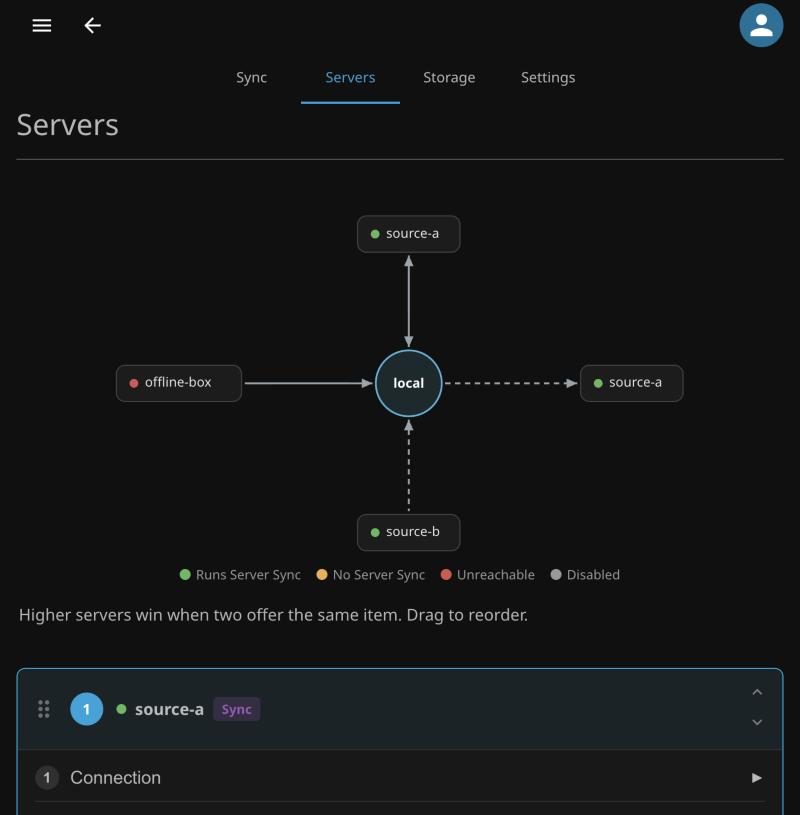
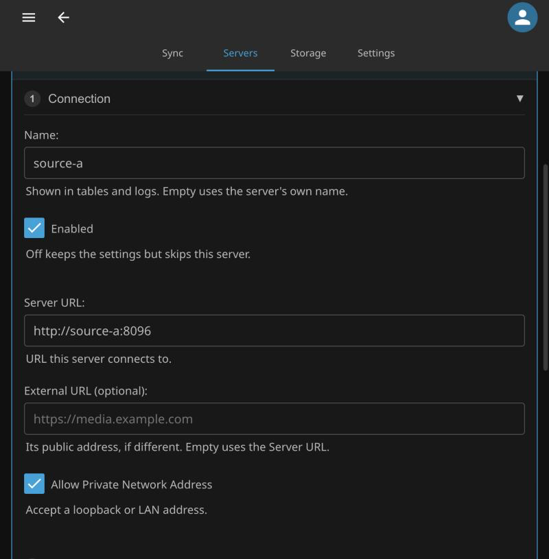
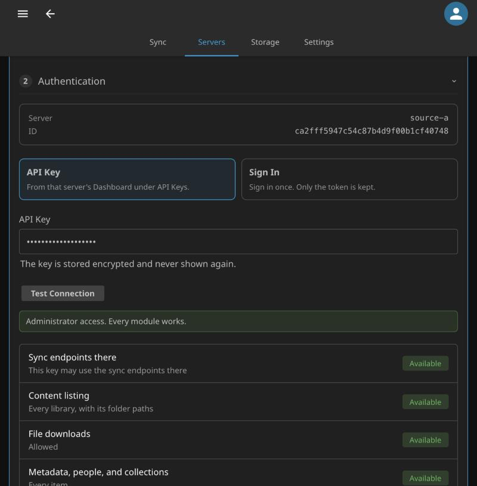
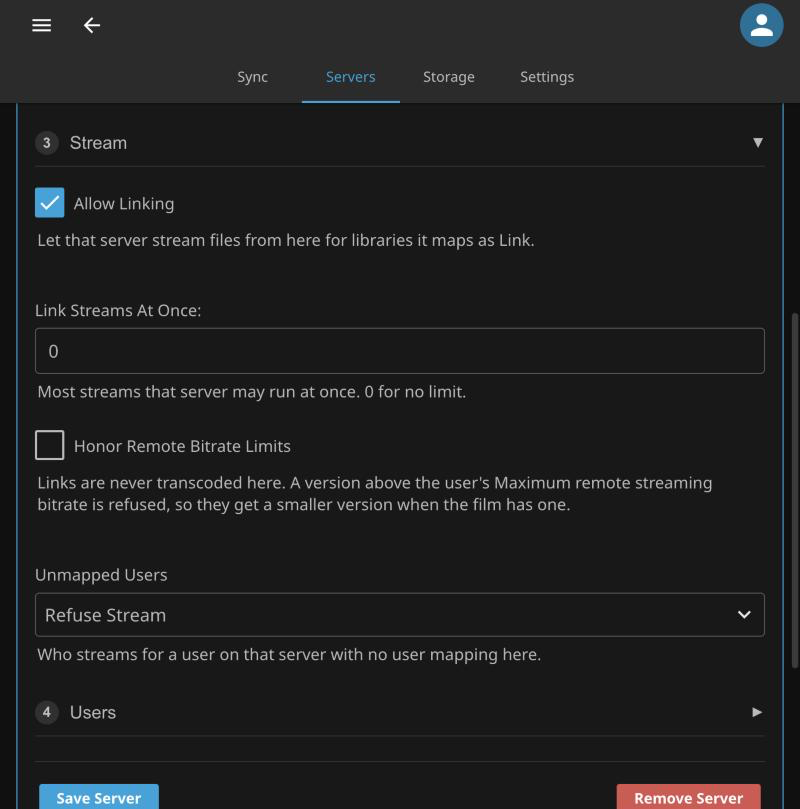
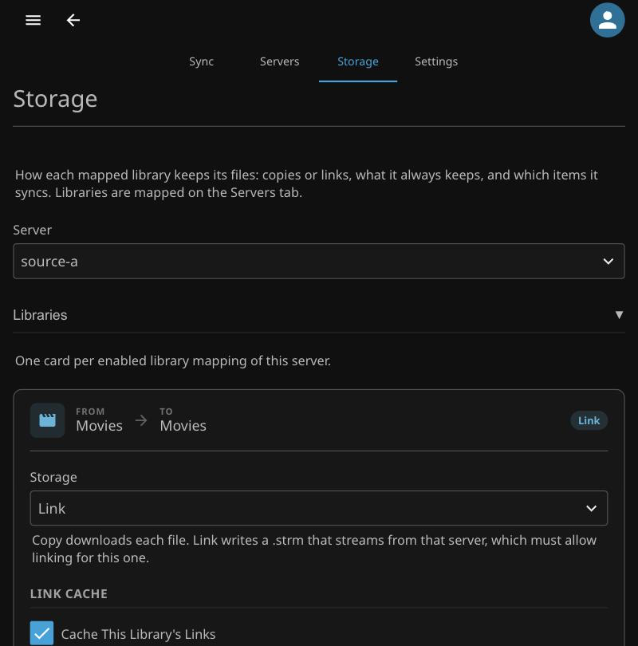
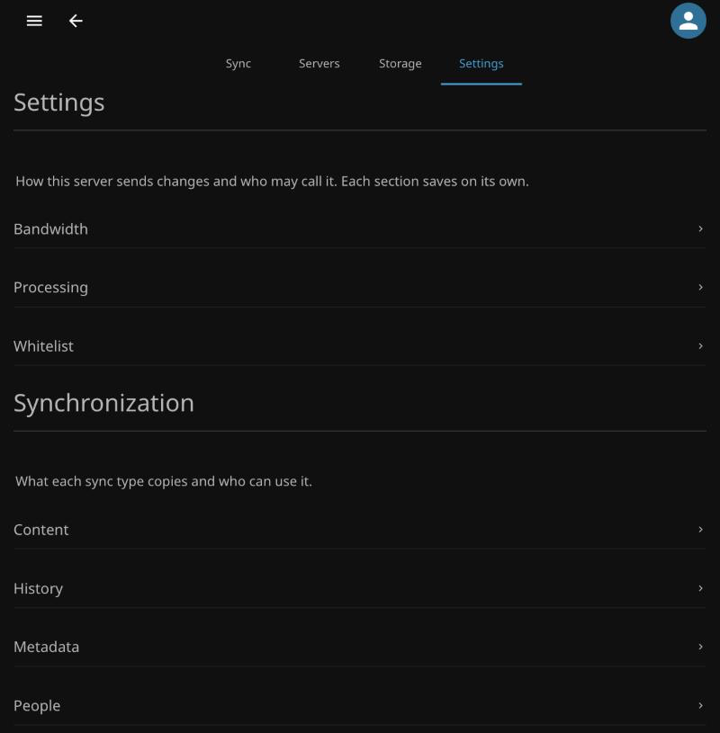

# Setup

The plugin has four tabs. **Sync** shows each module's table and the change queue. **Servers** holds the one time setup of the servers this one syncs with. **Storage**, shown while content, history, or metadata sync is on, holds how each mapped library keeps its files and which items it syncs. **Settings** holds the options.

## Servers

The map at the top shows this server, by its own name, and every server it is set up with, grouped by relationship. Every arrow points the way things travel. Pull points here, Push points out, and Sync both ways. The servers this one pulls from are always on the left, the servers it pushes to on the right, and the servers it syncs with below, and each lane's line is the colour of that relationship's badge on the server cards. Each server's dot is green when it runs Server Sync, orange when it answers without it, red when it cannot be reached, and grey when it is disabled.

Servers higher in the list win when two offer the same item. Drag a server to change the order. Each server has these steps.

| Step | What it holds |
| :--- | :--- |
| 1. Connection | Name, Server URL, an optional External URL, and whether a LAN address is allowed |
| 2. Authentication | An API key or a sign in, Test Connection, what the key can do there, and the Direction |
| 3. Stream | For Push and Sync servers: Allow Linking, the stream limit, bitrate limits, and who unmapped users stream as. A warning shows when that server does not run Server Sync |
| 4. Libraries | Which library there maps to which library here, and their root folders. How each one keeps its files is set on the [Storage](#storage) tab |
| 5. Users | Which user there maps to which user here, for history, user settings, and playlists, and, with Allow Linking on, that user's own link stream limit and speed |

**The other server needs Server Sync for everything but a plain pull.** A server that runs plain Jellyfin can be a **Pull** server whose libraries are kept as copies, and nothing else. Saving an entry as Push or Sync, or with a library kept as links, is refused when that server answers and does not run Server Sync. A server that cannot be reached is saved, since it cannot be asked, and nothing is sent to it until it answers.

Steps are numbered in the order they show, so a Pull server's Libraries is step 3.

| Connection | Authentication |
| :--- | :--- |
|  |  |

| Library Mapping | User Mapping |
| :--- | :--- |
|  |  |

**Test Connection** shows who the key belongs to, whether it may download, whether Server Sync there lets it in, and what each module can do with it.

### Direction

| Direction | Needs Server Sync there | What happens |
| :--- | :--- | :--- |
| Pull | No | This server reads from that one on a schedule. Changes also arrive as they happen when that server pushes to this one |
| Push | Yes, listing this server as Pull or Sync | Changes made here are sent to that server as they happen, and it may download this server's files. This server reads nothing from it |
| Sync | Yes, listing this server as Sync | Both, for a pool of equals |

**Check Link** confirms the other server is set up for the chosen direction and reports the access it holds for this one.

### Links

**Allow Linking** in the Stream step, and **Storage** set to **Link** on the Storage tab, hold a library as `.strm` links that stream from the source instead of full copies. The source allows linking on its entry for this server, and this server sets Storage on its entry for the source. Links that are played can also be kept in a link cache, set under Content in Settings. A Pull server can never link here. See [Links](Links.md).

### Keys and Permissions

A standard user's key works in every direction, limited to what that user can see and that user's own history, settings, and playlists. An administrator's key or an API key reaches everything. See [Permissions](Permissions.md) for each function.

## Storage

The Storage tab shows while content, history, or metadata sync is on. Pick a server, and each of its enabled library mappings has a card. With content sync off, only the filter and history settings show:

| Setting | What it holds |
| :--- | :--- |
| Storage | Full **Copy** files, the default, which follow that server: a file it removes is handled by **Removed files** here. Or **Link** files, which stream from any server that holds the file and go only when none holds it. See [Links](Links.md) |
| Link Cache | For a Link library, whether its played links are kept in the link cache |
| Always Keep | For a Link library, the shows and films that are full copies instead of links |
| Library Filter | **Allow All**, or a **Whitelist** or **Blacklist** of files, collections, and playlists. It applies to content, history, and metadata. See [Content](Content.md#collection-syncing) |
| Negotiate History | For a Sync server, while history sync is on, whether merged watch history is written back to that server. See [History](History.md) |

Below the cards, **Permanent Copies** lists the full copies held in that server's Link libraries and why each is a copy. **Turn Back Into Links** makes the selected copies links again: the link is written, then the copy moves into the link cache, or is removed when the cache is off or full. The source must still have the file. A copy covered by an Always Keep pick stays a copy until the pick is removed.

## Settings

| Section | What it holds |
| :--- | :--- |
| Bandwidth | Every speed limit, in Mbps, where 0 is no limit: **Downloads**, shared by every download to this server, and a **Streams to** row for each server allowed to link. Each has a **Normal** and a **Scheduled** speed. **Scheduled Speed** uses the second during the set hours, in server time, where equal hours run all day |
| Processing | How long changes wait before they are sent, retries, parallelism, and how often a full scan runs |
| Whitelist | Who may call this server's sync endpoints. Administrators and API keys calling from an enabled server on the Servers tab always may. Add users with the locations they may call from |
| Content, History, Metadata, People, Playlists, Users | One section per sync type, each with a table of what a standard user and an administrator can do. Options that do not apply are hidden |
| Troubleshooting | Table resets, which forget tracking but never touch media |

!!! note "Updating from before 12.2.7.0"
    Servers that pull from this one without being on its Servers tab need a Whitelist row here. The update adds API keys and every administrator with all locations so nothing breaks. Narrow those rows to lock it down.
